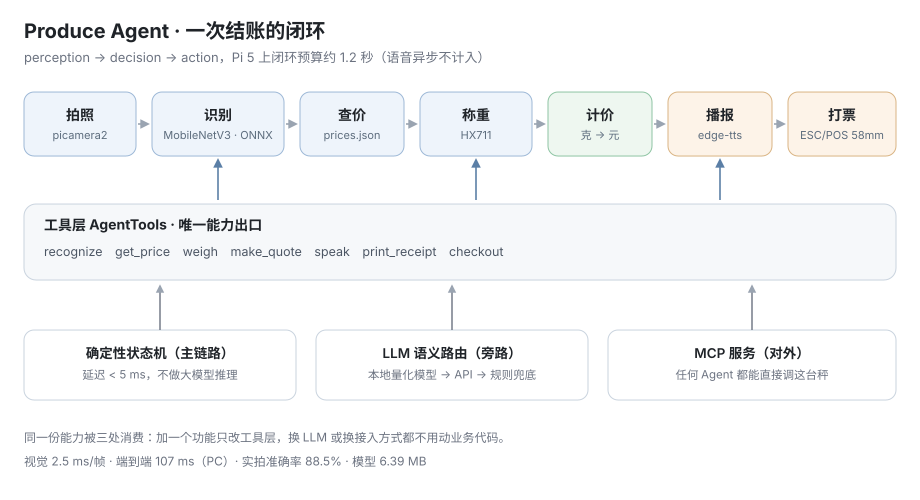

# Produce Agent


树莓派上的果蔬计价秤。放上商品，它自己完成识别、查价、称重、计价、语音播报和小票打印。

同一套能力有三处出口：命令行状态机、LLM function calling、MCP 服务。



实测（PC，i9-13900H）：

- 闭环 104–111 ms/单，指放货到小票生成；语音异步播放，不计入
- 视觉推理 2.5 ms/帧（P50），P95 3.1 ms
- 模型 6.39 MB，MobileNetV3-Small fp32
- 准确率：白底验证集 96.2%，实拍留出集 88.5%，加拒识后保留样本 97.6%
- 拒识：真商品误拒 9.6%，非商品检出 95.6%
- 长稳：40 单连续跑，首 10 均 111.3 ms → 末 10 均 106.1 ms，临时文件与线程数不增长

## 快速开始

```bash
pip install -r requirements-pc.txt
python manage.py demo        # 单件闭环
python manage.py cart        # 一单多件
python manage.py test        # 25 个用例
```

不接硬件也能跑完整闭环，摄像头和秤走 mock，小票写到 `out/`，订单追加到 `out/sales.jsonl`。

模型文件不入库。可以直接从 [Releases](https://github.com/HeimRig/produce-scale-agent/releases/download/v1.1.0/produce_mobilenetv3s.onnx) 下载放进 `models/`，也可以按下面的步骤自己训练。

全部命令见 `python manage.py help`：

| 命令 | 作用 |
|---|---|
| `demo` / `cart` | 单件 / 多件演示 |
| `run` / `chat` | 单次结账（可 `--loop`、`--weight`）/ 自然语言 |
| `mcp` | 启动 MCP stdio 服务 |
| `fetch` / `prepare` / `train` / `export` | 数据与模型流水线 |
| `eval` / `threshold` / `summary` | 实拍评估 / 单边误拒扫描 / 当日成交汇总 |
| `negative` / `eval-neg` / `curve` | 抓非果蔬负样本 / 测未知检出率 / 联合标定阈值 |
| `stability` | 连续 N 单长稳测试 |

## 实测数据

### 白底训练集换到实拍场景会失效

| 训练数据 | 白底验证集 | 实拍留出集 |
|---|---|---|
| 只用 Fruits-360（白底棚拍） | 97.5% | 38.0%（208 张） |
| 白底 + 约 700 张实拍混训 | 96.2% | 88.5%（261 张） |

骨干网和类别都没变，只改了训练数据构成。实拍从 38.0% 升到 88.5%，白底指标下降 1.3 个点。明细见 `docs/REALSHOT_REPORT.md`。

### 不确定就不报价

收银场景里认错比认不出代价大，所以识别结果要过两道闸：top1 置信度、top1 与 top2 的差值。任一低于阈值就拒识，语音提示重放，不进入计价。

| 指标 | 数值 | 测法 |
|---|---|---|
| 误拒率（真商品被拦） | 9.6% | 261 张实拍留出集 |
| 未知检出率（非商品被拦） | 95.6% | 456 张非果蔬图 |
| 保留样本准确率 | 97.6% | 上面 261 张扣掉被拒的 |

两组数据缺一不可：只看误拒率会以为放宽阈值没成本，只看检出率会以为收紧阈值没代价。

| conf | 误拒率 | 未知检出率 | 每 100 单加权代价 |
|---|---|---|---|
| 0.45 | 6.1% | 88.8% | 62.1 |
| **0.55（采用）** | **9.6%** | **95.6%** | **31.5** |
| 0.65 | 17.2% | 98.0% | 27.1 |

阈值是联合标定的：正样本算误拒、负样本算检出，代价按「一次误判 = 5 次误拒」加权。纯代价最优在 0.65，但那意味着每 6 单就有一次「没认出来」，柜台体验不能接受，所以往回收一档到 0.55，代价从 27.1 涨到 31.5，换来重放率从 17.2% 降到 9.6%。这是项目里唯一一个「模型给最优、人往回收」的决策。

被拒的帧自动落到 `data/unknown/`，是下一轮的训练素材。

负样本用的是 Caltech-101 里 12 个非果蔬类（手机、手表、耳机、杯子、剪刀、扳手、笔记本等）。最弱的是剪刀 90%、订书机 87%、扳手 87%，细长金属物容易被判成黄瓜或辣椒；手机 95%、笔记本 100%。

两个边界：一是 Caltech-101 是 2003 年的网图，分辨率约 300×200，和托盘上手机拍摄的画面不同，它能回答「模型面对非果蔬会不会硬猜」，答不了「在你这张桌子上表现如何」；二是这些图上没有托盘，真实场景还多一层背景干扰。

明细见 `docs/REJECT_REPORT.md`、`docs/NEGATIVE_REPORT.md`、`docs/THRESHOLD_CURVE.md`。

### 长稳：40 单不漂移

语音异步播报意味着每单都会起线程，很容易变成「线程与临时文件只增不减」。修完跑 40 单连续测试（`python manage.py stability --orders 40 --interval 1`）：

| 指标 | 数值 |
|---|---|
| 单均 / P50 / P95 | 107.4 / 107.2 / 118.8 ms |
| 首 10 单 → 末 10 单 | 111.3 → 106.1 ms |
| 临时 mp3 残留 | 0 → 0 |
| 线程峰值 | 10，不随单数增长 |
| RSS | +9.4 MB（12 单时 +7.8，增长趋平，不是线性泄漏） |

间隔短于语音时长（合成 1.4s + 播放约 5s）时会主动丢弃播报，上限 3 个并发——宁可少说一句，也不让播放器进程堆积。见 `docs/STABILITY_REPORT.md`。

### INT8 量化在这个模型上不可用

| 方案 | 体积 | 与 fp32 预测一致率 |
|---|---|---|
| 静态 QDQ（Int8，MinMax 校准） | 2.03 MB | 15.0% |
| QOperator（Int8，per-channel） | 1.76 MB | 15.0% |
| 只量化 Conv / MatMul / Gemm | 2.06 MB | 20.0% |
| fp32（最终采用） | 6.39 MB | 100% |

动态量化更低，早期版本只有 10.3%。hard-swish 和 SE 模块对定点数敏感，三条路径的一致率都掉到 20% 以下，量化后的模型基本相当于随机猜。fp32 在 PC 上 P50 是 2.5 ms，按 6 倍估算在 Pi 5 上也在预算内，所以交付 fp32。要用 int8 需要做 QAT，见 `docs/ARCHITECTURE.md`。

## 设计说明

### 主链路是状态机，LLM 只做意图判断

结账流程是纯 Python 状态机，延迟低于 5 ms。大模型只负责判断"这个多少钱一斤"该调哪个工具。

本地 Ollama（qwen2.5-3B-Q4）实测单次解析 180 ms，冷启动首次请求 6 s，比收银链路慢三个数量级，所以它不参与交易流程。降级顺序是 Ollama、云端 API、关键词规则。

一个实测出来的细节：模型抽参数不可靠。让它处理"来两斤番茄"，会算成 200 克（应为 1000 克）；说"结账"，会凭空编出 `item_key=apple, grams=100`。所以最终是模型只输出 `action`，商品键和重量由正则加价目表匹配决定。

### 工具层是唯一出口

`AgentTools` 同时被状态机、function calling 和 MCP 消费。新增能力只改这一层，换 LLM 或换接入方式都不动业务代码。

### 一单可以多件

`checkout` 是单件闭环，`add_to_cart` / `remove_item` / `checkout_all` 走购物车。两条路共用同一份计价和小票格式化代码，多件小票每件带序号，合计只算一次。订单统一追加到 `out/sales.jsonl`，`manage.py summary` 按天汇总单数、件数、金额和商品排名。

### 精度优先

量化验证不过就不上线。见上面的一致性数据。

## 目录

```
produce-agent/
├── manage.py                  统一入口，所有命令从这一处进
├── demo.py                    一键演示（--cart 走多件）
├── config.py                  全局配置，电脑和 Pi 的差异都在这里
├── app/
│   ├── main.py                命令行入口：单次结账 / 循环 / 自然语言
│   ├── log.py                 logging 初始化，业务输出仍走 print
│   ├── perception/            camera（picamera2 / webcam / mock）、scale（HX711 / mock）
│   ├── vision/                classifier（ONNX Runtime）、labels、imageops
│   ├── agent/                 tools（能力出口）、planner（Ollama / API / 规则）、pricing、report
│   └── action/                tts（edge / piper / pyttsx3）、printer（ESC/POS）
├── mcp_server.py              MCP 服务，14 个工具
├── tests/                     pytest，25 个用例
├── scripts/                   数据下载、采集、清洗、训练、导出、评估、阈值标定、压测、标定
├── models/                    模型与 labels.json（不入库）
└── docs/                      架构、数据集、性能、准确率、拒识、长稳、BOM、演示分镜
```

## 1. 准备数据

```bash
# 白底主力源，Fruits-360 的 113 类自动映射到本项目的 12 类
python scripts/fetch_dataset.py --source fruits360 --split train --per-class 300

# 补胡萝卜，Fruits-360 里没有这个类
python scripts/fetch_dataset.py --source fruidet --per-class 30

# 实拍源，用来消除白底与真实场景的差异
python scripts/fetch_dataset.py --source realshot  --split test  --per-class 40
python scripts/fetch_dataset.py --source realshot2 --split train --per-class 80
python scripts/fetch_dataset.py --source fruidet --only avocado --out-dir data/realshot_extra
python scripts/split_realshot.py            # 首次划分，留出 30%
python scripts/merge_realshot.py --move     # 之后新抓的图按 30/70 分

# 非果蔬负样本，只用于测拒识，不进训练
python scripts/fetch_negative.py --per-class 40
```

也可以自己拍（`CAMERA_BACKEND` 支持 `mock` / `webcam` / `picamera2`）：

```bash
python scripts/collect.py --source webcam --classes apple banana orange
python scripts/collect.py --source dir --dir D:\photos\apple --class apple
```

采集时会丢弃模糊帧和重复帧。实时采集用 8×8 aHash，汉明距离阈值 5；离线清洗用 16×16，阈值 1。阈值放太松会把整个类判成一张，早期用 8×8 阈值 5 跑黄瓜，60 张只剩 6 张。采集规范见 `docs/DATASET.md`。

## 2. 训练与导出

```bash
python scripts/prepare_dataset.py --clean   # 清洗并划分，实拍只进训练集
python scripts/finetune.py                  # 微调 8 轮，1000 张时 CPU 约 2 分钟
python scripts/export_onnx.py               # 导出 fp32，同时试量化并校验一致率
python scripts/bench.py                     # 压测，写 docs/PERF_REPORT.md
python scripts/eval_realshot.py             # 白底与实拍对比，写 docs/REALSHOT_REPORT.md
python scripts/fetch_negative.py            # 抓非果蔬负样本
python scripts/threshold_curve.py           # 正负样本联合标定阈值，写 docs/THRESHOLD_CURVE.md
python scripts/eval_negative.py             # 未知检出率，写 docs/NEGATIVE_REPORT.md
python scripts/stability.py --orders 40     # 长稳，写 docs/STABILITY_REPORT.md
```

## 3. 自然语言入口

可选。装了 [Ollama](https://ollama.com) 就能用人话下指令，没装会自动退回关键词规则。

```bash
ollama pull qwen2.5:3b
python manage.py chat "苹果多少钱一斤"
python manage.py chat "再来两斤番茄"
python manage.py chat "今天卖了多少单"
```

`config.py` 里 `LLM_BACKEND` 可选 `auto` / `ollama` / `api` / `off`，`auto` 按 Ollama、云端 API、规则依次降级。

## 4. 树莓派部署

改 `config.py` 四项：

```python
CAMERA_BACKEND = "picamera2"
SCALE_BACKEND  = "hx711"
TTS_BACKEND    = "edge"      # 断网用 piper 或 pyttsx3
PRINTER_BACKEND = "mock"     # 接了打印机再改 serial / usb
```

```bash
sudo apt install -y python3-picamera2 python3-lgpio python3-venv
python3 -m venv --system-site-packages ~/pa-venv && source ~/pa-venv/bin/activate
pip install -r requirements-pi.txt
python scripts/calibrate.py        # 去皮，再放 500g 砝码标定，写入 scale.json
python -m app.main --loop
```

启动时打印的 `[后端]` 里出现 `Hx711LibScale`，说明称重驱动接上了。

U 盘拷贝，电脑端（在项目目录打开 PowerShell）：

```powershell
$src = (Get-Location).Path
$dst = "E:\produce-agent"
New-Item -ItemType Directory -Force -Path $dst | Out-Null
robocopy $src $dst /E /XD out .git __pycache__ data /XF *.pyc
Copy-Item "$src\models\*.onnx","$src\models\labels.json" "$dst\models\" -ErrorAction SilentlyContinue
```

树莓派端：

```bash
lsblk
sudo mkdir -p /mnt/usb && sudo mount /dev/sda1 /mnt/usb
mkdir -p ~/produce-agent && cp -r /mnt/usb/produce-agent/. ~/produce-agent/
sudo umount /mnt/usb
```

## 5. MCP 接入

```bash
pip install mcp
python mcp_server.py
python scripts/mcp_smoke.py     # 冒烟测试，不用接客户端
```

暴露 14 个工具：`checkout`、`add_to_cart`、`remove_item`、`list_cart`、`checkout_all`、`clear_cart`、`sales_summary`、`recognize_produce`、`get_price`、`weigh`、`make_quote`、`speak`、`print_receipt`、`list_items`。在 MCP 客户端里登记启动命令即可调用。

兼容 mcp 1.x 和 2.x。2.x 把 `FastMCP` 改名成 `MCPServer`，`mcp_server.py` 里做了 import 兜底。

## License

MIT
